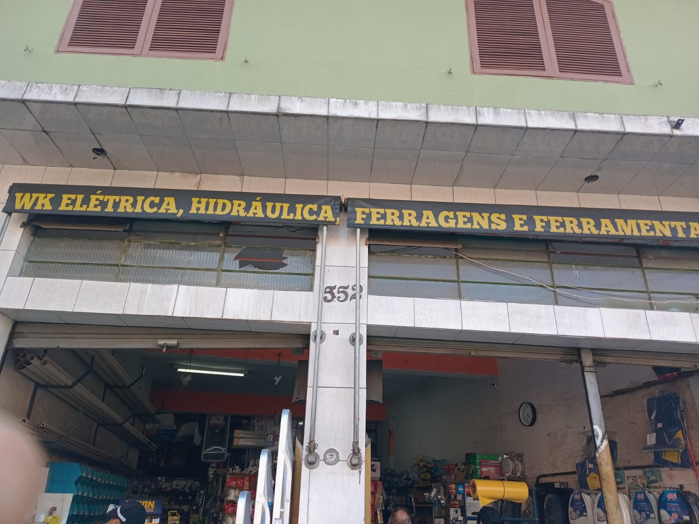
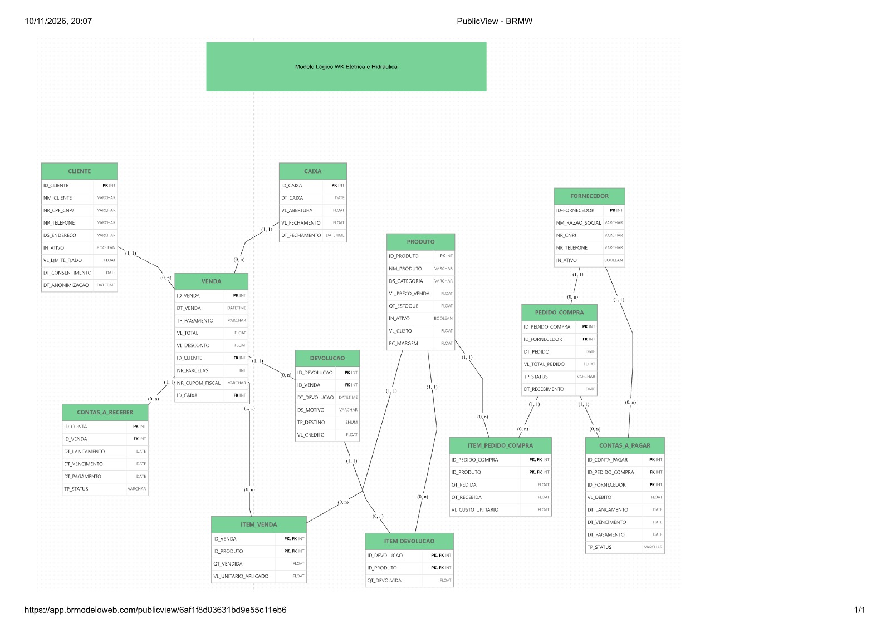

# Entrega 2 — Modelo Lógico, Implementação SQL e Apresentação Final

## Sistema de gestão para a WK Elétrica, Hidráulica, Ferragens e Ferramentas

Projeto acadêmico de Modelagem de Banco de Dados voltado à organização das informações de vendas presenciais, produtos, estoque, clientes, fornecedores, compras, devoluções e acompanhamento financeiro da WK Elétrica, Hidráulica, Ferragens e Ferramentas.

## Integrantes

| Nome completo | RGM | Usuário do GitHub |
|---|---|---|
| Matheus Pedrosa dos Reis | 46784721 | [@Omatheuspedrosa](https://github.com/Omatheuspedrosa) |
| Pablo Orlando Bizari Di Sisto | 46695737 | [@PabloBizari](https://github.com/PabloBizari) |
| Vithor Hugo Moreno de Carvalho | 46761926 | [@vithorcarvalho-blip](https://github.com/vithorcarvalho-blip) |

**Repositório:** [PabloBizari/Banco-de-Dados](https://github.com/PabloBizari/Banco-de-Dados)  
**SGBD:** MySQL 8.0.16 ou posterior, com InnoDB.  
**Banco:** `wk_materiais`.

## Sumário

- [1. Relatório Técnico Final](#relatorio)
  - [1.1 Revisão do Modelo Conceitual](#revisao)
  - [1.2 Conversão do Modelo Conceitual para o Modelo Lógico](#conversao)
  - [1.3 Definição de Chaves Primárias e Estrangeiras](#chaves)
  - [1.4 Processo de Normalização](#normalizacao)
  - [1.5 Justificativas Técnicas das Decisões](#justificativas)
  - [1.6 Proposta de Arquitetura Analítica para BI e IA](#bi)
- [2. Modelo Lógico Relacional](#logico)
- [3. Script SQL](#sql)
- [4. Massa de Dados](#massa)
- [5. Repositório GitHub e Dicionário de Dados](#repositorio)
- [6. Uso de Inteligência Artificial](#ia)
- [7. Apresentação Corporativa Final](#apresentacao)

<a id="relatorio"></a>
## 1. Relatório Técnico Final

O projeto dá continuidade ao estudo da organização real escolhido na Entrega 1. A documentação relaciona as necessidades levantadas, os requisitos e regras, as tabelas e chaves, as decisões de normalização e o potencial de análise dos dados.

<a id="revisao"></a>
### 1.1 Revisão do Modelo Conceitual

#### Caracterização da organização

| Informação | Descrição |
|---|---|
| Nome utilizado no projeto | WK Elétrica, Hidráulica, Ferragens e Ferramentas |
| Identificação comercial | WK Elétrica, Hidráulica, Ferragens e Ferramentas |
| Atividade | Comércio varejista de materiais de construção, ferragens e ferramentas |
| Endereço | Rua Cônego Antônio Dias Pequeno, nº 552, Jardim Tietê, São Paulo — SP |
| CEP | 03945-050 |
| Responsável entrevistado | Wanderley; nome Wanderley de Oliveira localizado no cadastro histórico da WK |
| Contato comercial divulgado | (11) 2018-1146 |
| CNPJ informado na documentação inicial | 30.112.168/0001-50 |
| Nome empresarial associado ao CNPJ informado | David Caravanti de Oliveira |
| Natureza | Organização comercial privada de pequeno porte |

O nome de Wanderley de Oliveira aparece no cadastro histórico de W K Elétrica, Hidráulica, Ferragens e Ferramentas Ltda., CNPJ 09.464.263/0001-26. Esse cadastro histórico, baixado, é distinto do CNPJ informado na documentação inicial. Wanderley é apresentado neste projeto como responsável entrevistado, não como titular jurídico comprovado do CNPJ atual. O telefone indicado é comercial, publicado em diretório, não um contato pessoal confirmado.

Fontes públicas de identificação:

- [Divulgação comercial da WK](https://obra.net.br/sobre/wk-eletrica-hidraulica-ferragens-e-ferramentas-sao-paulo-sp-13225420).
- [Consulta do CNPJ informado](https://publica.cnpj.ws/cnpj/30112168000150).
- [Consulta do cadastro histórico da WK](https://brasilapi.com.br/api/cnpj/v1/09464263000126).
- [Pesquisa da localização no Google Maps](https://www.google.com/maps/search/?api=1&query=WK+Rua+Conego+Antonio+Dias+Pequeno+552+Sao+Paulo).

O link do Google Maps é uma pesquisa de localização, não uma afirmação de que o perfil comercial tenha sido reivindicado ou validado pelo grupo.

#### Contexto e porte

Segundo o relato do responsável, a equipe possui quatro pessoas: o responsável, dois balconistas e um estoquista. O atendimento foi estimado em cerca de 25 vendas por dia, com faturamento diário médio relatado de R$ 1.200,00.

A documentação inicial registra aproximadamente 18 anos e seis meses de atuação no endereço. Esse tempo corresponde ao relato sobre a operação comercial, não ao tempo de existência do CNPJ informado. A loja trabalha com materiais de construção, ferragens e ferramentas, com destaque relatado para miudezas e itens de fácil transporte. A retirada é realizada no estabelecimento, sem serviço de entrega relatado.

As estimativas de porte e movimento provêm da entrevista, não de auditoria contábil.

#### Problemas e necessidades

| Código | Problema | Necessidade de informação |
|---|---|---|
| P1 | Controle financeiro manual | Organizar registros de caixa, recebimentos e compromissos |
| P2 | Histórico de vendas não estruturado | Consultar transações, itens e modalidades de pagamento |
| P3 | Controle informal do estoque | Identificar produtos, saldos e necessidades de reposição |
| P4 | Fiado anotado de forma manual | Identificar devedores, valores e quitações |
| P5 | Trocas e devoluções sem histórico estruturado | Relacionar o retorno do produto à venda de origem |
| P6 | Compras e reposição sob demanda | Acompanhar fornecedores, pedidos e recebimentos |

O relato indica uso de papel e consultas verbais de preço e disponibilidade. Não foi apresentada mensuração de perdas; os problemas são tratados como dificuldades de gestão de informações.

#### Escopo e justificativa

O modelo integra o ciclo comercial e financeiro documentado: cadastro de clientes e produtos, venda e seus itens, caixa, fiado, fornecedores, compras, contas a pagar e devoluções. As informações deixam de ser tratadas como controles isolados e passam a ser relacionadas por identificadores.

A organização foi escolhida pela possibilidade de contato com seu responsável e pela presença de processos adequados ao estudo de modelagem. A proximidade da residência de Vithor facilitou a visita. Não foi informado vínculo empregatício ou familiar dos integrantes com a organização.

#### Entrevista e levantamento

| Elemento | Registro |
|---|---|
| Data informada | 20 de setembro |
| Local | Estabelecimento da WK, no endereço apresentado acima |
| Entrevistado | Wanderley, responsável pelo estabelecimento |
| Participante presencial | Vithor Hugo Moreno de Carvalho |
| Preparação | Perguntas elaboradas conjuntamente pelos três integrantes |
| Organização da participação | Vithor realizou a entrevista por morar próximo e ter disponibilidade; os demais não puderam comparecer na data |

A entrevista abordou atendimento, orçamento, pagamentos, estoque, fiado, compras e devoluções. O resumo das respostas fundamenta a descrição dos processos deste relatório.

**Respostas do entrevistado:** operação predominantemente manual, estimativas de equipe e vendas, retirada no local, modalidades de pagamento, desconto para dinheiro/PIX, fiado baseado em confiança e reposição sob demanda.

**Observação presencial:** o grupo não registrou achados independentes além do que foi relatado por Wanderley. As fotografias documentam a visita e o local.

#### Evidências

- [Fotografia da fachada](./FOTO1.jpg).
- [Fotografia da visita](./FOTO2.jpg).




#### Processos de negócio e dados envolvidos

| Processo | Descrição e dados |
|---|---|
| Atendimento e consulta de produtos | Busca por código, nome, categoria, preço e saldo; na operação relatada, consulta verbal ou presencial |
| Cadastro de cliente | Identificação, nome, documento, telefone, endereço e situação; o protótipo também prevê limite de fiado e datas de consentimento/anonimização |
| Venda presencial | Data/hora, modalidade, valor total, desconto, cliente quando aplicável, parcelas, referência fiscal e caixa; itens com produto, quantidade e preço praticado |
| Fiado | Venda ligada ao cliente e conta com valor, lançamento, vencimento, pagamento e situação |
| Troca/devolução | Venda de origem, data/hora, motivo, destino, crédito registrado e produtos/quantidades devolvidos |
| Compras | Fornecedor com razão social, CNPJ, telefone e situação; pedido com data, valor, situação e recebimento; itens com produto, quantidades pedida/recebida e custo |
| Contas a pagar | Pedido, fornecedor, débito, lançamento, vencimento, pagamento e situação |
| Caixa | Data, valor de abertura, fechamento e momento de fechamento, com vendas vinculadas |
| Produto e estoque | Nome, categoria, preço atual, saldo, situação, custo e percentual armazenado |

Caixa, controles financeiros formais e campos complementares representam decisões da solução proposta. Sua presença no modelo não significa que já fossem utilizados formalmente na operação manual.

**Processos considerados e não incluídos:** entrega e frete não foram incluídos porque o responsável relatou retirada no local. E-commerce e fidelização não foram identificados no levantamento. Folha de pagamento, escala, produção própria e integração fiscal não foram detalhados na entrevista e não são apresentados como processos confirmados ou como funções implementadas.

Prazos de troca, parcelamento, emissão fiscal, vencimento/cobrança do fiado e formação de preço não foram confirmados em detalhe. Os campos correspondentes do protótipo não são apresentados como política comercial aprovada.

#### Requisitos funcionais

| Código | Requisito |
|---|---|
| RF01 | Cadastrar e consultar produto com código, nome, categoria, preço, quantidade em estoque, situação, custo e percentual do cadastro |
| RF02 | Cadastrar cliente com nome, documento, telefone, endereço e situação; identificar o cliente no fiado e permitir os dados complementares previstos no modelo |
| RF03 | Registrar venda com data/hora, modalidade, total, desconto, cliente, parcelas, referência fiscal, caixa e itens com produto, quantidade e preço aplicado |
| RF04 | Representar desconto de 5% para pagamento em dinheiro ou PIX |
| RF05 | Registrar conta a receber vinculada à venda e ao cliente, com débito, lançamento, vencimento, quitação e situação |
| RF06 | Registrar devolução com venda de origem, data/hora, motivo, destino, crédito e produtos/quantidades |
| RF07 | Cadastrar fornecedores e pedidos com data, total, situação, recebimento e itens com quantidade e custo |
| RF08 | Conferir o mínimo relatado de R$ 1.500,00 por pedido ao fornecedor |
| RF09 | Atualizar e consultar saldo de estoque conforme vendas, recebimentos e devoluções elegíveis |
| RF10 | Organizar caixa por data, abertura e fechamento, vinculando as vendas |
| RF11 | Registrar contas a pagar vinculadas a pedido e fornecedor, com valor, datas e situação |
| RF12 | Disponibilizar consultas gerenciais de vendas, estoque, compras, devoluções e contas |

Os requisitos expressam o comportamento pretendido da solução. As restrições efetivamente declaradas no SQL são descritas na seção 1.5.

#### Requisitos não funcionais

| Código | Característica | Critério proposto |
|---|---|---|
| RNF01 | Usabilidade | Interface simples para atendimento de balcão |
| RNF02 | Desempenho | Meta inicial de abertura/fechamento de venda em menos de dois segundos, a verificar em teste |
| RNF03 | Integridade | Preservar vínculo de movimentos com vendas, devoluções ou compras e coerência entre documentos e itens |
| RNF04 | Segurança | Aplicar acesso compatível com a função do usuário |
| RNF05 | Privacidade | Coletar e expor apenas dados necessários à finalidade |
| RNF06 | Rastreabilidade | Relacionar problemas, regras, dados e consultas |
| RNF07 | Recuperabilidade | Prever cópia de segurança e procedimento de restauração |

#### Regras de negócio e controles

Os códigos RN01–RN05 correspondem às regras operacionais RO01–RO05 da documentação inicial. Os demais identificam controles do modelo proposto.

| Código | Regra | Origem |
|---|---|---|
| RN01 | Desconto de 5% para dinheiro ou PIX | Relato inicial |
| RN02 | Retirada das mercadorias na loja, sem entrega/frete | Relato inicial |
| RN03 | Venda fiada vinculada a cliente cadastrado | Formalização do controle proposto |
| RN04 | Mínimo de R$ 1.500,00 por pedido ao fornecedor | Relato inicial |
| RN05 | Registrar crédito ou troca na devolução | Relato inicial, sem política detalhada |
| RN06 | Quantidades positivas e valores válidos | Controle técnico |
| RN07 | Totais coerentes com itens e desconto | Controle técnico |
| RN08 | Saldo de estoque não negativo | Controle técnico |
| RN09 | Modalidade válida de pagamento | Domínio do protótipo |
| RN10 | Venda vinculada a caixa; um caixa por data | Decisão de implementação |
| RN11 | Produto único dentro do mesmo documento | Decisão das PKs compostas |
| RN12 | No máximo uma conta por venda/pedido | Simplificação financeira |
| RN13 | Cliente/fornecedor da conta coerente com o documento de origem | Controle técnico |
| RN14 | Devolução de produto vendido, sem exceder a quantidade original | Controle técnico |
| RN15 | Acesso e exposição de dados conforme finalidade | Diretriz de governança |

O cliente obrigatório no fiado não torna CPF/CNPJ obrigatório: o documento é anulável no SQL. A descrição da devolução representa o tratamento do protótipo, não uma restrição universal a reembolso nem política jurídica validada.

#### Tratamento dos temas de revisão da Entrega 1

| Tema da revisão | Tratamento nesta documentação | Justificativa |
|---|---|---|
| Evidências visíveis | Inclusão das fotografias com links e exibição no README | Vincular a caracterização ao local visitado |
| Identificação da entrevista | Registro da data informada, entrevistado, participante e preparação conjunta | Distinguir participação presencial da colaboração dos demais |
| Processos e dados | Detalhamento dos dados em processos e requisitos | Relacionar o levantamento às estruturas do projeto |
| Dicionário conceitual e físico | Separação da descrição de negócio e das restrições físicas | Evitar confundir atributo conceitual com coluna/constraint |
| Itens de documentos | Explicitação de venda, compra e devolução com seus produtos e quantidades | Representar os grupos repetitivos e os valores negociados |
| Regras e integridade | Identificação de RN01–RN15 e das restrições correspondentes | Tornar as justificativas rastreáveis |

A tabela registra os tratamentos documentais descritos; não atribui ao professor apontamentos literais não reproduzidos nem certifica alterações gráficas a partir da edição do texto.

<a id="conversao"></a>
### 1.2 Conversão do Modelo Conceitual para o Modelo Lógico

Cada cadastro ou documento foi representado por uma tabela. Os grupos repetitivos de produtos foram separados em tabelas de itens.

| Elemento | Tabela | Conteúdo principal |
|---|---|---|
| Cliente | `CLIENTE` | Identificação, contato, situação e campos complementares |
| Produto | `PRODUTO` | Catálogo, preço, saldo e custo |
| Fornecedor | `FORNECEDOR` | Identificação e contato |
| Caixa | `CAIXA` | Abertura e fechamento por data |
| Venda | `VENDA` | Cabeçalho comercial |
| Item vendido | `ITEM_VENDA` | Produto, quantidade e preço por venda |
| Conta a receber | `CONTAS_A_RECEBER` | Débito do cliente |
| Devolução | `DEVOLUCAO` | Evento ligado à venda |
| Item devolvido | `ITEM_DEVOLUCAO` | Produto e quantidade por evento |
| Pedido de compra | `PEDIDO_COMPRA` | Cabeçalho da compra |
| Item comprado | `ITEM_PEDIDO_COMPRA` | Quantidades e custo por pedido |
| Conta a pagar | `CONTAS_A_PAGAR` | Compromisso com fornecedor |

**Atributos para colunas:** identificadores usam `INT`; nomes/documentos/contatos usam `VARCHAR`; valores e quantidades usam `DECIMAL(10,2)`; percentual usa `DECIMAL(5,2)`; datas usam `DATE` ou `DATETIME`; indicadores usam `BOOLEAN`; parcelas usam `TINYINT`; destino da devolução usa `ENUM`.

Documentos e telefones são texto para preservar zeros e sinais. O endereço é uma descrição textual única. Se forem necessários múltiplos telefones ou endereços, a representação adequada será uma tabela dependente, não listas dentro de uma coluna.

**Relacionamentos para chaves:** relações 1:N usam FK na tabela dependente. Relações N:N entre documento e produto foram resolvidas com `ITEM_VENDA`, `ITEM_PEDIDO_COMPRA` e `ITEM_DEVOLUCAO`. A limitação de uma conta por documento utiliza FK mais `UNIQUE`.

**Generalização/especialização:** não há hierarquia de entidades no modelo atual. Modalidades de pagamento são valores de um atributo, não subclasses. Também não foi utilizado autorrelacionamento.

<a id="chaves"></a>
### 1.3 Definição de Chaves Primárias e Estrangeiras

| Tabela | PK | FKs — coluna e destino | Unicidade adicional |
|---|---|---|---|
| `CLIENTE` | `ID_CLIENTE` | — | — |
| `PRODUTO` | `ID_PRODUTO` | — | — |
| `FORNECEDOR` | `ID_FORNECEDOR` | — | `NR_CNPJ` |
| `CAIXA` | `ID_CAIXA` | — | `DT_CAIXA` |
| `VENDA` | `ID_VENDA` | `ID_CLIENTE → CLIENTE.ID_CLIENTE`; `ID_CAIXA → CAIXA.ID_CAIXA` | — |
| `ITEM_VENDA` | (`ID_VENDA`, `ID_PRODUTO`) | `ID_VENDA → VENDA.ID_VENDA`; `ID_PRODUTO → PRODUTO.ID_PRODUTO` | PK composta |
| `CONTAS_A_RECEBER` | `ID_CONTA` | `ID_VENDA → VENDA.ID_VENDA`; `ID_CLIENTE → CLIENTE.ID_CLIENTE` | `ID_VENDA` |
| `DEVOLUCAO` | `ID_DEVOLUCAO` | `ID_VENDA → VENDA.ID_VENDA` | — |
| `ITEM_DEVOLUCAO` | (`ID_DEVOLUCAO`, `ID_PRODUTO`) | `ID_DEVOLUCAO → DEVOLUCAO.ID_DEVOLUCAO`; `ID_PRODUTO → PRODUTO.ID_PRODUTO` | PK composta |
| `PEDIDO_COMPRA` | `ID_PEDIDO_COMPRA` | `ID_FORNECEDOR → FORNECEDOR.ID_FORNECEDOR` | — |
| `ITEM_PEDIDO_COMPRA` | (`ID_PEDIDO_COMPRA`, `ID_PRODUTO`) | `ID_PEDIDO_COMPRA → PEDIDO_COMPRA.ID_PEDIDO_COMPRA`; `ID_PRODUTO → PRODUTO.ID_PRODUTO` | PK composta |
| `CONTAS_A_PAGAR` | `ID_CONTA_PAGAR` | `ID_PEDIDO_COMPRA → PEDIDO_COMPRA.ID_PEDIDO_COMPRA`; `ID_FORNECEDOR → FORNECEDOR.ID_FORNECEDOR` | `ID_PEDIDO_COMPRA` |

São nove PKs simples com incremento automático, três PKs compostas e quatorze FKs. `VENDA.ID_CLIENTE` é a única FK anulável.

#### Cardinalidades convertidas

| Relação | Leitura |
|---|---|
| Cliente–Venda | Cliente possui 0:N vendas; venda possui 0:1 cliente, obrigatório no fiado |
| Caixa–Venda | Caixa possui 0:N vendas; venda possui um caixa |
| Venda–Item | Venda concluída deve ter 1:N itens; item pertence a uma venda |
| Produto–Item de venda | Produto aparece em 0:N itens; item aponta para um produto |
| Venda–Conta a receber | Venda possui 0:1 conta; conta pertence a uma venda |
| Cliente–Conta a receber | Cliente possui 0:N contas; conta possui um cliente |
| Venda–Devolução | Venda possui 0:N devoluções; evento pertence a uma venda |
| Devolução–Item devolvido | Evento deve ter 1:N itens; item pertence a um evento |
| Produto–Item devolvido | Produto aparece em 0:N itens; item aponta para um produto |
| Fornecedor–Pedido | Fornecedor possui 0:N pedidos; pedido possui um fornecedor |
| Pedido–Item comprado | Pedido confirmado deve ter 1:N itens; item pertence a um pedido |
| Produto–Item comprado | Produto aparece em 0:N itens; item aponta para um produto |
| Pedido–Conta a pagar | Pedido possui 0:1 conta; conta pertence a um pedido |
| Fornecedor–Conta a pagar | Fornecedor possui 0:N contas; conta possui um fornecedor |

FKs garantem a existência da referência, não o mínimo de um item no cabeçalho. As PKs compostas impedem repetir o produto no mesmo documento. O SQL não declara `ON DELETE CASCADE` ou `ON UPDATE CASCADE`.

<a id="normalizacao"></a>
### 1.4 Processo de Normalização

#### Primeira Forma Normal — 1FN

A separação entre cabeçalhos e itens elimina grupos repetitivos. Uma venda não contém colunas como `produto_1`, `produto_2` e `produto_3`, nem uma lista textual de mercadorias: cada produto ocupa uma linha em `ITEM_VENDA`. A mesma organização ocorre em compras e devoluções.

Isso permite consultar, contar e agregar produtos sem interpretar texto livre. Cadastros devem manter um valor por campo; contatos múltiplos exigem relações próprias.

#### Segunda Forma Normal — 2FN

Os atributos de cada tabela de itens dependem da combinação completa da PK.

| Associação | Dependência completa | Dados separados |
|---|---|---|
| `ITEM_VENDA` | Venda + produto determinam quantidade e preço praticado | Nome/categoria em `PRODUTO`; data no cabeçalho |
| `ITEM_PEDIDO_COMPRA` | Pedido + produto determinam quantidade e custo negociado | Fornecedor/data em `PEDIDO_COMPRA` |
| `ITEM_DEVOLUCAO` | Devolução + produto determinam quantidade devolvida | Motivo/data/destino em `DEVOLUCAO` |

A decomposição evita dependências parciais e atualizações repetidas de informações do cadastro ou cabeçalho.

#### Terceira Forma Normal — 3FN

Nome, documento e contato do cliente ficam em `CLIENTE`, não repetidos em cada venda. Razão social, CNPJ e contato do fornecedor ficam em `FORNECEDOR`, não em cada item de compra. Essa separação reduz dependências transitivas de atributos descritivos nos documentos.

Os vínculos de cliente na conta a receber e de fornecedor na conta a pagar repetem informações recuperáveis pelo documento de origem. Como a referência ao documento é `UNIQUE NOT NULL`, constitui também chave candidata da conta: a repetição, isoladamente, não prova violação formal da 3FN local, embora demande correspondência entre relações.

`PC_MARGEM` deve ser interpretado com sua regra de cálculo. O exemplo inicial calcula `(preço − custo) / custo × 100`, isto é, acréscimo sobre custo (markup), não margem sobre receita. Armazenar um percentual estritamente derivado exige controle de atualização ou cálculo em consulta.

Totais e saldo são dados materializados. Devem ser mantidos e auditados contra itens e movimentos. A avaliação da normalização depende dessas semânticas, não apenas da existência de PKs simples.

**Justificativa:** a 1FN viabiliza tratar cada item; a 2FN separa atributos do produto e do documento; a 3FN reduz repetição de dados descritivos. Preço praticado e custo negociado permanecem nos itens por pertencerem à transação histórica.

<a id="justificativas"></a>
### 1.5 Justificativas Técnicas das Decisões

#### Chaves e preservação do histórico

Identificadores numéricos evitam usar nome, documento ou telefone como chave estrutural. Esses dados podem mudar sem alterar os vínculos comerciais. As PKs compostas expressam a identificação de cada produto no documento (RN11).

As FKs implementam os vínculos da seção 1.3. Cliente/caixa da venda atendem RN03 e RN10; os vínculos dos itens sustentam RN11/RN14; referências e unicidades das contas implementam o limite máximo de RN12.

#### Restrições e regras correspondentes

| Restrição | Aplicação | Finalidade |
|---|---|---|
| PK | Todas as tabelas | Identificação única; RN11 nas associativas |
| FK | Quatorze referências | Existência do cadastro/documento referenciado |
| `NOT NULL` | Campos obrigatórios do esquema | Presença estrutural de informação |
| `UNIQUE(NR_CNPJ)` | `FORNECEDOR` | Evitar duplicidade textual do CNPJ |
| `UNIQUE(DT_CAIXA)` | `CAIXA` | Um caixa por data — RN10 |
| `UNIQUE(ID_VENDA)` | `CONTAS_A_RECEBER` | No máximo uma conta por venda — RN12 |
| `UNIQUE(ID_PEDIDO_COMPRA)` | `CONTAS_A_PAGAR` | No máximo uma conta por pedido — RN12 |
| `CHECK(QT_ESTOQUE >= 0)` | `PRODUTO` | Saldo não negativo — RN08 |
| `CHECK` da modalidade | `VENDA` | `DINHEIRO`, `PIX`, `DEBITO`, `CREDITO`, `FIADO` — RN09 |
| `CHECK` condicional | `VENDA` | Cliente obrigatório no fiado — RN03 |
| `ENUM('CREDITO','TROCA')` | `DEVOLUCAO.TP_DESTINO` | Tratamentos do protótipo — RN05 |
| Padrão `TRUE` | Indicadores ativos | Estado cadastral inicial |
| Padrão 0 | Estoque, abertura, desconto e crédito | Valor inicial, não cálculo automático |
| Padrão 1 | Número de parcelas | Valor inicial |
| Padrão `ABERTO` | Contas a pagar/receber | Situação inicial |

O desconto, o mínimo de compra, a correspondência dos totais e a quantidade devolvida são regras de processo a conferir por aplicação e auditoria; não são efeitos automáticos das FKs. Os status financeiros são `VARCHAR`, não domínios fechados por `CHECK`. `BOOLEAN` no MySQL não restringe sozinho todos os valores ao par 0/1.

#### Decisões arquiteturais

- **Precisão:** `DECIMAL` para dinheiro e quantidades; evita tratar valores financeiros como `FLOAT`.
- **Histórico:** preço aplicado e custo negociado ficam nos itens, independentes do preço atual.
- **Transações:** operações de documento, itens, contas e estoque devem ser atômicas em InnoDB.
- **Cliente opcional:** cadastro dispensável em venda não fiada; obrigatório no fiado.
- **Caixa:** organização por dia, sem divisão por terminal no esquema atual.
- **Cadastros ativos:** inativação separada da exclusão de documentos históricos.
- **Codificação:** `utf8mb4` e `utf8mb4_unicode_ci`, conforme o SQL.
- **Índices:** PKs, unicidades e suporte das FKs; não se atribuem ao script índices adicionais de nome/data não declarados.
- **Referência fiscal:** `NR_CUPOM_FISCAL` armazena texto; não equivale a emissão fiscal.
- **Parcelamento:** `NR_PARCELAS` descreve a venda, sem representar uma tabela individual de parcelas.

#### Acesso e privacidade

| Papel proposto | Operações |
|---|---|
| Responsável | Gestão de cadastros, compras, contas e relatórios |
| Balconista | Consulta de produtos e registro de clientes/vendas |
| Estoquista | Consulta e operações autorizadas de estoque |
| Processo analítico | Leitura preferencialmente agregada |
| Administrador técnico | Manutenção, backup e configuração de acessos |

A matriz é uma proposta, não comandos `GRANT` já executados. Dados pessoais devem ser coletados e expostos conforme necessidade. Datas de consentimento e anonimização não substituem definição de finalidade, retenção, acesso e procedimentos aplicáveis (RN15).

<a id="bi"></a>
### 1.6 Proposta de Arquitetura Analítica para BI e IA

#### Informações estratégicas e arquitetura

O modelo apoia acompanhamento de vendas, produtos mais vendidos, modalidades, contas vencidas, compras e devoluções. A proposta usa quatro camadas:

1. **Operacional:** MySQL com cadastros e documentos.
2. **Extração e qualidade:** auditorias, padronização e extrações periódicas.
3. **Analítica:** fatos e dimensões organizados por granularidade.
4. **Consumo:** dashboards, relatórios e experimentos de IA.

Fato de venda tem uma linha por venda; fato de item tem uma linha por venda/produto; fatos financeiros têm uma linha por conta; devoluções possuem fatos de evento e item. Dimensões incluem calendário, produto/categoria, fornecedor e modalidade. Dados identificáveis de clientes ficam restritos à análise que os necessite.

Itens, contas e devoluções devem ser agregados antes de cruzamentos que possam multiplicar o total do cabeçalho. A arquitetura é uma proposta de BI, não declaração de um data warehouse já implantado.

#### Indicadores e rastreabilidade

Os códigos G identificam o catálogo de consultas desta documentação. As metas comerciais não foram definidas com o responsável.

| KPI | Fórmula e unidade | Período | Tabelas | Consulta de referência |
|---|---|---|---|---|
| K01 — Vendas registradas | Soma de `VL_TOTAL`, em R$, após desconto registrado e antes de devoluções | Mensal | `VENDA` | G02 |
| K02 — Ticket médio | Soma de `VL_TOTAL` / quantidade de vendas, em R$ | Mensal | `VENDA` | G02 |
| K03 — Vendas por dia com venda | Vendas / datas distintas com venda | Mensal | `VENDA` | G02 |
| K04 — Participação da modalidade | Vendas da modalidade / total do mês × 100 | Mensal | `VENDA` | G03 |
| K05 — Produtos no limiar | Ativos com saldo ≤ parâmetro / total de ativos × 100 | Posição atual | `PRODUTO` | G05 |
| K06 — Valor vencido a receber | Soma de débitos não pagos vencidos antes da referência, em R$ | Data de referência | `CONTAS_A_RECEBER`, `VENDA`, `CLIENTE` | G06 |
| K07 — Proporção vencida | Valor vencido / total não pago × 100 | Data de referência | `CONTAS_A_RECEBER`, `VENDA`, `CLIENTE` | G06 |
| K08 — Incidência de devolução | Vendas do mês com devolução / vendas daquele mês × 100 | Coorte mensal | `VENDA`, `DEVOLUCAO` | G08 |
| K09 — Valor vencido a pagar | Soma de débitos a fornecedores não pagos e vencidos, em R$ | Data de referência | `CONTAS_A_PAGAR`, `PEDIDO_COMPRA`, `FORNECEDOR` | G09 |
| K10 — Prazo de recebimento | Média de recebimento − pedido, em dias | Mês do pedido | `PEDIDO_COMPRA` | G10 |

O limiar de K05 é parametrizável, não estoque mínimo confirmado por produto. K03 considera somente dias com vendas. K06/K09 pressupõem quitação integral, pois o esquema não registra pagamentos parciais. K08 considera devoluções registradas até a referência e pode mudar com novos eventos.

| Problema | Tabelas envolvidas | Consulta de referência |
|---|---|---|
| P1 — Controle financeiro | `CAIXA`, `VENDA`, contas | G01, G09 |
| P2 — Histórico de vendas | `VENDA`, `ITEM_VENDA`, `PRODUTO` | G02, G03, G04 |
| P3 — Estoque | `PRODUTO`, `VENDA`, itens, pedidos | G04, G05, G10 |
| P4 — Fiado | `CLIENTE`, `VENDA`, `CONTAS_A_RECEBER` | G06 |
| P5 — Devoluções | `VENDA`, `DEVOLUCAO`, `ITEM_DEVOLUCAO` | G08 |
| P6 — Compras | `FORNECEDOR`, pedidos, contas a pagar | G07, G09, G10 |

#### Aplicações analíticas e de IA

- **Demanda:** prever quantidades por produto/categoria, com separação temporal entre treino e avaliação e comparação com uma previsão simples.
- **Reposição:** combinar demanda, saldo e prazo de recebimento; unidades, mínimos e histórico de movimentos devem orientar a interpretação.
- **Associação de produtos:** identificar coocorrência de itens na mesma venda.
- **Qualidade:** priorizar divergências de desconto, total e devolução, começando por regras SQL determinísticas.
- **Fiado:** apoiar acompanhamento administrativo de vencimentos, com acesso restrito e revisão humana, sem negativa automática de crédito.

A massa fictícia demonstra técnicas e consultas; não comprova capacidade preditiva na organização real. O uso de IA no desenho dessas propostas está declarado na seção 6.

<a id="logico"></a>
## 2. Modelo Lógico Relacional

O diagrama lógico foi elaborado no **brModelo Web**. Sua representação apresenta tabelas, colunas, tipos, marcas PK/FK e ligações com cardinalidades. As restrições adicionais são descritas no dicionário e no SQL.

- [Modelo lógico — JPEG](./Modelo_Logico_BR_Modelo.jpeg).
- [Visualização do modelo lógico — HTML](./MODELO_LOGICO.html).
- [DER disponível — PNG](./WK_Materiais_DER_Profissional.png).



O DER foi produzido com apoio do Perplexity a partir de um script preparado com apoio do Gemini. Não foi informado o aplicativo de renderização desse DER. A modelagem conceitual descreve entidades, atributos e relacionamentos; tipos físicos e chaves estrangeiras pertencem à representação lógica/física.

<a id="sql"></a>
## 3. Script SQL

**Arquivo:** [WK_Materiais.sql](./WK_Materiais.sql).

O banco chama-se `wk_materiais`. O arquivo reúne criação do banco/tabelas, restrições, dados de exemplo, massa fictícia e atualizações auxiliares.

### Ambiente e execução

```sql
SELECT VERSION() AS versao,
       @@default_storage_engine AS mecanismo,
       @@sql_mode AS modo_sql;
```

Utilizar MySQL 8.0.16 ou posterior, mecanismo padrão InnoDB e instalação de testes com banco vazio. Importação pelo terminal:

```bash
mysql --default-character-set=utf8mb4 -u SEU_USUARIO -p < WK_Materiais.sql
```

`SEU_USUARIO` corresponde à conta local do MySQL. A criação de banco usa `IF NOT EXISTS`, mas a carga inteira não é idempotente. Uma nova execução deve ocorrer em ambiente de teste adequado, sem apagar dados de produção.

### Catálogo das consultas gerenciais

Os códigos abaixo especificam as consultas propostas e sua rastreabilidade; não afirmam, por si só, sua incorporação ao arquivo SQL.

| Código | Pergunta de gestão | Cálculo e relacionamento |
|---|---|---|
| G01 | Quais valores foram registrados por dia no caixa e nas contas? | Agregar `VENDA` por caixa; agregar contas por pagamento; relacionar as datas a `CAIXA`, sem multiplicação por itens |
| G02 | Qual o total vendido, ticket e volume médio por mês? | Somar `VENDA.VL_TOTAL`, contar vendas e datas distintas e calcular média |
| G03 | Qual a participação das modalidades por mês? | Agrupar vendas por mês/modalidade e dividir a quantidade pelo total mensal |
| G04 | Quais produtos possuem maior valor bruto de itens vendidos? | `ITEM_VENDA` com `VENDA` e `PRODUTO`; somar quantidade × preço aplicado |
| G05 | Quantos produtos ativos estão no limiar parametrizado de estoque? | Filtrar `PRODUTO.IN_ATIVO` e comparar saldo com parâmetro |
| G06 | Qual o total não pago e vencido do fiado por cliente? | Contas com venda fiada e cliente; usar vencimento e data de pagamento |
| G07 | Quanto foi pedido por fornecedor e situação? | `PEDIDO_COMPRA` com `FORNECEDOR`, somando total por situação |
| G08 | Qual a incidência de devolução por mês da venda? | Agregar devoluções por venda antes do cruzamento; contar vendas com evento |
| G09 | Quais compromissos não pagos e vencidos existem por fornecedor? | Contas com pedido e fornecedor; excluir pedidos cancelados e usar datas |
| G10 | Qual o prazo médio de recebimento das compras? | Média de `DATEDIFF(DT_RECEBIMENTO, DT_PEDIDO)` nos pedidos recebidos com data |

G01 mostra registros, não conciliação completa de numerário: recebimentos de fiado não possuem modalidade própria e não há registro completo de sangrias/despesas. G04 mostra valor bruto dos itens, não receita final líquida nem lucro.

### Consultas gerenciais de referência

```sql
USE wk_materiais;
SET @inicio = '2026-05-11';
SET @fim = '2026-11-11';
SET @data_ref = '2026-11-11';
SET @limiar = 30;

-- G01 — Quais registros financeiros existem por dia?
-- Atende: P1.
WITH v AS (
  SELECT ID_CAIXA, COUNT(*) AS qtd, SUM(VL_TOTAL) AS total
  FROM VENDA GROUP BY ID_CAIXA
), r AS (
  SELECT DT_PAGAMENTO AS dia, SUM(VL_DEBITO) AS total
  FROM CONTAS_A_RECEBER WHERE DT_PAGAMENTO IS NOT NULL
  GROUP BY DT_PAGAMENTO
), p AS (
  SELECT DT_PAGAMENTO AS dia, SUM(VL_DEBITO) AS total
  FROM CONTAS_A_PAGAR WHERE DT_PAGAMENTO IS NOT NULL
  GROUP BY DT_PAGAMENTO
)
SELECT c.DT_CAIXA, c.VL_ABERTURA, c.VL_FECHAMENTO,
       COALESCE(v.qtd,0) AS vendas, COALESCE(v.total,0) AS valor_vendas,
       COALESCE(r.total,0) AS recebido_fiado,
       COALESCE(p.total,0) AS pago_fornecedores
FROM CAIXA c LEFT JOIN v ON v.ID_CAIXA=c.ID_CAIXA
LEFT JOIN r ON r.dia=c.DT_CAIXA LEFT JOIN p ON p.dia=c.DT_CAIXA
WHERE c.DT_CAIXA>=@inicio AND c.DT_CAIXA<@fim ORDER BY c.DT_CAIXA;

-- G02 — Qual o total, ticket e volume por mês?
-- Atende: P2; K01, K02, K03.
SELECT DATE_FORMAT(DT_VENDA,'%Y-%m') AS mes, COUNT(*) AS vendas,
       ROUND(SUM(VL_TOTAL),2) AS total, ROUND(AVG(VL_TOTAL),2) AS ticket,
       COUNT(DISTINCT DATE(DT_VENDA)) AS dias_com_venda,
       ROUND(COUNT(*)/NULLIF(COUNT(DISTINCT DATE(DT_VENDA)),0),2) AS media_dia
FROM VENDA WHERE DT_VENDA>=@inicio AND DT_VENDA<@fim
GROUP BY DATE_FORMAT(DT_VENDA,'%Y-%m') ORDER BY mes;

-- G03 — Qual a participação das modalidades por mês?
-- Atende: P2; K04.
WITH b AS (
  SELECT DATE_FORMAT(DT_VENDA,'%Y-%m') AS mes, TP_PAGAMENTO, COUNT(*) AS qtd
  FROM VENDA WHERE DT_VENDA>=@inicio AND DT_VENDA<@fim
  GROUP BY DATE_FORMAT(DT_VENDA,'%Y-%m'),TP_PAGAMENTO
)
SELECT mes,TP_PAGAMENTO,qtd,
       ROUND(100.0*qtd/SUM(qtd) OVER(PARTITION BY mes),2) AS percentual
FROM b ORDER BY mes,qtd DESC;

-- G04 — Quais produtos lideram o valor bruto dos itens?
-- Atende: P2 e P3.
SELECT p.ID_PRODUTO,p.NM_PRODUTO,SUM(i.QT_VENDIDA) AS quantidade,
       ROUND(SUM(i.QT_VENDIDA*i.VL_UNITARIO_APLICADO),2) AS bruto
FROM ITEM_VENDA i JOIN VENDA v ON v.ID_VENDA=i.ID_VENDA
JOIN PRODUTO p ON p.ID_PRODUTO=i.ID_PRODUTO
WHERE v.DT_VENDA>=@inicio AND v.DT_VENDA<@fim
GROUP BY p.ID_PRODUTO,p.NM_PRODUTO ORDER BY bruto DESC;

-- G05 — Quantos produtos ativos estão no limiar de estoque?
-- Atende: P3; K05. Limiar demonstrativo, não mínimo por produto.
SELECT COUNT(*) AS ativos,COALESCE(SUM(QT_ESTOQUE<=@limiar),0) AS no_limiar,
       ROUND(100.0*SUM(QT_ESTOQUE<=@limiar)/NULLIF(COUNT(*),0),2) AS percentual
FROM PRODUTO WHERE IN_ATIVO=TRUE;

-- G06 — Qual o saldo não pago e vencido do fiado?
-- Atende: P4; K06 e K07.
WITH b AS (
 SELECT c.ID_CLIENTE,c.NM_CLIENTE,SUM(r.VL_DEBITO) AS nao_pago,
        SUM(CASE WHEN r.DT_VENCIMENTO<@data_ref THEN r.VL_DEBITO ELSE 0 END) AS vencido
 FROM CONTAS_A_RECEBER r JOIN CLIENTE c ON c.ID_CLIENTE=r.ID_CLIENTE
 JOIN VENDA v ON v.ID_VENDA=r.ID_VENDA
 WHERE v.TP_PAGAMENTO='FIADO' AND r.DT_LANCAMENTO<=@data_ref
   AND (r.DT_PAGAMENTO IS NULL OR r.DT_PAGAMENTO>@data_ref)
 GROUP BY c.ID_CLIENTE,c.NM_CLIENTE
)
SELECT b.*,SUM(vencido) OVER() AS total_vencido,
       ROUND(100.0*SUM(vencido) OVER()/NULLIF(SUM(nao_pago) OVER(),0),2) AS percentual_total
FROM b ORDER BY vencido DESC;

-- G07 — Quanto foi pedido por fornecedor e situação?
-- Atende: P6.
SELECT f.ID_FORNECEDOR,f.NM_RAZAO_SOCIAL,p.TP_STATUS,
       COUNT(*) AS pedidos,SUM(p.VL_TOTAL_PEDIDO) AS total
FROM PEDIDO_COMPRA p JOIN FORNECEDOR f ON f.ID_FORNECEDOR=p.ID_FORNECEDOR
WHERE p.DT_PEDIDO>=@inicio AND p.DT_PEDIDO<@fim
GROUP BY f.ID_FORNECEDOR,f.NM_RAZAO_SOCIAL,p.TP_STATUS;

-- G08 — Qual a incidência de devolução por coorte mensal?
-- Atende: P5; K08.
WITH d AS (
 SELECT ID_VENDA,COUNT(*) AS eventos FROM DEVOLUCAO
 WHERE DATE(DT_DEVOLUCAO)<=@data_ref GROUP BY ID_VENDA
)
SELECT DATE_FORMAT(v.DT_VENDA,'%Y-%m') AS mes,COUNT(*) AS vendas,
       COUNT(d.ID_VENDA) AS vendas_com_devolucao,
       ROUND(100.0*COUNT(d.ID_VENDA)/NULLIF(COUNT(*),0),2) AS incidencia
FROM VENDA v LEFT JOIN d ON d.ID_VENDA=v.ID_VENDA
WHERE v.DT_VENDA>=@inicio AND v.DT_VENDA<@fim
GROUP BY DATE_FORMAT(v.DT_VENDA,'%Y-%m') ORDER BY mes;

-- G09 — Qual o valor não pago e vencido por fornecedor?
-- Atende: P1 e P6; K09.
WITH b AS (
 SELECT f.ID_FORNECEDOR,f.NM_RAZAO_SOCIAL,SUM(a.VL_DEBITO) AS nao_pago,
        SUM(CASE WHEN a.DT_VENCIMENTO<@data_ref THEN a.VL_DEBITO ELSE 0 END) AS vencido
 FROM CONTAS_A_PAGAR a JOIN FORNECEDOR f ON f.ID_FORNECEDOR=a.ID_FORNECEDOR
 JOIN PEDIDO_COMPRA p ON p.ID_PEDIDO_COMPRA=a.ID_PEDIDO_COMPRA
 WHERE a.DT_LANCAMENTO<=@data_ref
   AND (a.DT_PAGAMENTO IS NULL OR a.DT_PAGAMENTO>@data_ref)
   AND p.TP_STATUS<>'CANCELADO'
 GROUP BY f.ID_FORNECEDOR,f.NM_RAZAO_SOCIAL
)
SELECT b.*,SUM(vencido) OVER() AS total_vencido FROM b ORDER BY vencido DESC;

-- G10 — Qual o prazo médio de recebimento das compras?
-- Atende: P3 e P6; K10.
SELECT DATE_FORMAT(DT_PEDIDO,'%Y-%m') AS mes,COUNT(*) AS recebidos,
       COUNT(DT_RECEBIMENTO) AS com_data,
       ROUND(AVG(DATEDIFF(DT_RECEBIMENTO,DT_PEDIDO)),2) AS prazo_dias
FROM PEDIDO_COMPRA
WHERE TP_STATUS='RECEBIDO' AND DT_PEDIDO>=@inicio AND DT_PEDIDO<@fim
GROUP BY DATE_FORMAT(DT_PEDIDO,'%Y-%m') ORDER BY mes;
```

### Consultas de auditoria de referência

Auditorias retornam candidatos a inconsistência conforme a regra pesquisada; resultado vazio não equivale a validação integral do banco.

```sql
-- A01 — Há desconto diferente de 5% no dinheiro/PIX?
-- Verifica: RN01. Base adotada: valor bruto dos itens.
WITH b AS (
 SELECT ID_VENDA,SUM(QT_VENDIDA*VL_UNITARIO_APLICADO) AS bruto
 FROM ITEM_VENDA GROUP BY ID_VENDA
)
SELECT v.ID_VENDA,v.VL_DESCONTO,b.bruto
FROM VENDA v JOIN b ON b.ID_VENDA=v.ID_VENDA
WHERE ABS(v.VL_DESCONTO-CASE WHEN v.TP_PAGAMENTO IN('DINHEIRO','PIX')
 THEN ROUND(b.bruto*0.05,2) ELSE 0 END)>0.01;

-- A02 — O fiado possui conta e cliente coerentes?
-- Verifica: RN03, RN12, RN13.
SELECT v.ID_VENDA,v.ID_CLIENTE,r.ID_CONTA,r.ID_CLIENTE AS cliente_conta
FROM VENDA v LEFT JOIN CONTAS_A_RECEBER r ON r.ID_VENDA=v.ID_VENDA
WHERE (v.TP_PAGAMENTO='FIADO' AND (v.ID_CLIENTE IS NULL OR r.ID_CONTA IS NULL))
 OR (v.TP_PAGAMENTO<>'FIADO' AND r.ID_CONTA IS NOT NULL)
 OR (r.ID_CONTA IS NOT NULL AND
    (NOT(r.ID_CLIENTE<=>v.ID_CLIENTE) OR ABS(r.VL_DEBITO-v.VL_TOTAL)>0.01));

-- A03 — Há pedido não cancelado abaixo do mínimo?
-- Verifica: RN04.
SELECT * FROM PEDIDO_COMPRA
WHERE TP_STATUS<>'CANCELADO' AND VL_TOTAL_PEDIDO<1500;

-- A04 — Há quantidade ou preço inválido em itens de venda?
-- Verifica: RN06.
SELECT * FROM ITEM_VENDA
WHERE QT_VENDIDA<=0 OR VL_UNITARIO_APLICADO<=0;

-- A05 — Há venda sem item ou com total divergente?
-- Verifica: RN07 e RN11.
WITH b AS (
 SELECT ID_VENDA,SUM(QT_VENDIDA*VL_UNITARIO_APLICADO) AS bruto
 FROM ITEM_VENDA GROUP BY ID_VENDA
)
SELECT v.ID_VENDA,v.VL_TOTAL,v.VL_DESCONTO,b.bruto
FROM VENDA v LEFT JOIN b ON b.ID_VENDA=v.ID_VENDA
WHERE b.ID_VENDA IS NULL OR v.VL_DESCONTO<0 OR v.VL_DESCONTO>b.bruto
 OR ABS(v.VL_TOTAL-ROUND(b.bruto-v.VL_DESCONTO,2))>0.01;

-- A06 — Há recebimento superior ao pedido ou quantidade inválida?
-- Verifica: RN06 e RN07.
SELECT * FROM ITEM_PEDIDO_COMPRA
WHERE QT_PEDIDA<=0 OR VL_CUSTO_UNITARIO<=0
 OR QT_RECEBIDA<0 OR QT_RECEBIDA>QT_PEDIDA;

-- A07 — Houve devolução de item não vendido ou além da quantidade?
-- Verifica: RN14.
WITH d AS (
 SELECT e.ID_VENDA,i.ID_PRODUTO,SUM(i.QT_DEVOLVIDA) AS devolvido
 FROM DEVOLUCAO e JOIN ITEM_DEVOLUCAO i ON i.ID_DEVOLUCAO=e.ID_DEVOLUCAO
 GROUP BY e.ID_VENDA,i.ID_PRODUTO
)
SELECT d.*,v.QT_VENDIDA FROM d LEFT JOIN ITEM_VENDA v
 ON v.ID_VENDA=d.ID_VENDA AND v.ID_PRODUTO=d.ID_PRODUTO
WHERE v.ID_PRODUTO IS NULL OR d.devolvido>v.QT_VENDIDA;

-- A08 — Há status ou datas incoerentes nas contas?
-- Verifica: RN06. Convenção do protótipo: ABERTO, ATRASADO, PAGO.
SELECT 'RECEBER' AS origem,ID_CONTA AS conta,TP_STATUS,
 DT_LANCAMENTO,DT_VENCIMENTO,DT_PAGAMENTO
FROM CONTAS_A_RECEBER
WHERE TP_STATUS NOT IN('ABERTO','ATRASADO','PAGO')
 OR DT_VENCIMENTO<DT_LANCAMENTO OR DT_PAGAMENTO<DT_LANCAMENTO
 OR (TP_STATUS='PAGO' AND DT_PAGAMENTO IS NULL)
 OR (TP_STATUS<>'PAGO' AND DT_PAGAMENTO IS NOT NULL)
UNION ALL
SELECT 'PAGAR',ID_CONTA_PAGAR,TP_STATUS,DT_LANCAMENTO,DT_VENCIMENTO,DT_PAGAMENTO
FROM CONTAS_A_PAGAR
WHERE TP_STATUS NOT IN('ABERTO','ATRASADO','PAGO')
 OR DT_VENCIMENTO<DT_LANCAMENTO OR DT_PAGAMENTO<DT_LANCAMENTO
 OR (TP_STATUS='PAGO' AND DT_PAGAMENTO IS NULL)
 OR (TP_STATUS<>'PAGO' AND DT_PAGAMENTO IS NOT NULL);

-- A09 — A venda pertence a caixa de outra data?
-- Verifica: RN10.
SELECT v.ID_VENDA,v.DT_VENDA,c.DT_CAIXA FROM VENDA v
JOIN CAIXA c ON c.ID_CAIXA=v.ID_CAIXA
WHERE DATE(v.DT_VENDA)<>c.DT_CAIXA;

-- A10 — A conta tem fornecedor divergente ou pedido cancelado?
-- Verifica: RN13.
SELECT a.ID_CONTA_PAGAR,a.ID_FORNECEDOR,p.ID_FORNECEDOR AS fornecedor_pedido,p.TP_STATUS
FROM CONTAS_A_PAGAR a JOIN PEDIDO_COMPRA p ON p.ID_PEDIDO_COMPRA=a.ID_PEDIDO_COMPRA
WHERE a.ID_FORNECEDOR<>p.ID_FORNECEDOR OR p.TP_STATUS='CANCELADO';
```

### Demonstração de UPDATE e DELETE

Exemplo técnico de criação, atualização e exclusão de um registro temporário, sem apagar documentos comerciais. Executar em tabelas InnoDB de laboratório.

```sql
START TRANSACTION;
INSERT INTO CLIENTE (NM_CLIENTE,IN_ATIVO)
VALUES ('REGISTRO TECNICO TEMPORARIO',TRUE);
SET @cliente_teste=LAST_INSERT_ID();
UPDATE CLIENTE SET IN_ATIVO=FALSE WHERE ID_CLIENTE=@cliente_teste;
SELECT ID_CLIENTE,NM_CLIENTE,IN_ATIVO FROM CLIENTE WHERE ID_CLIENTE=@cliente_teste;
DELETE FROM CLIENTE WHERE ID_CLIENTE=@cliente_teste;
ROLLBACK;
```

A transação é revertida; o identificador consumido pode não ser reutilizado. Os blocos desta seção são referências documentais e não substituem o artefato `.sql` separado.

<a id="massa"></a>
## 4. Massa de Dados

A massa está incluída em [WK_Materiais.sql](./WK_Materiais.sql) e foi gerada com apoio do Claude para demonstração acadêmica. Não representa uma exportação de operações ou de dados pessoais reais da loja.

O período simulado das vendas é de **11/05/2026 a 10/11/2026**. Alguns exemplos iniciais usam `CURDATE()` e suas datas dependem do dia da execução.

| Tabela | Registros | Papel na demonstração |
|---|---:|---|
| `CLIENTE` | 253 | Diversidade de cadastros, situações e recorrência |
| `PRODUTO` | 50 | Catálogo demonstrativo com categorias e saldos |
| `FORNECEDOR` | 15 | Comparação e distribuição das compras |
| `CAIXA` | 158 | Organização por datas com operação |
| `VENDA` | 3.598 | Histórico de aproximadamente seis meses |
| `ITEM_VENDA` | 5.917 | Vendas com um ou mais produtos |
| `CONTAS_A_RECEBER` | 306 | Vendas fiadas e situações financeiras |
| `DEVOLUCAO` | 77 | Eventos de retorno |
| `ITEM_DEVOLUCAO` | 91 | Produtos retornados por evento |
| `PEDIDO_COMPRA` | 191 | Compras em diferentes situações |
| `ITEM_PEDIDO_COMPRA` | 193 | Quantidades e custos negociados |
| `CONTAS_A_PAGAR` | 185 | Compromissos com fornecedores |

### Justificativa do volume

As 3.598 vendas distribuídas por 158 datas com venda equivalem a aproximadamente 22,8 vendas por data, ordem de grandeza próxima das 25 vendas diárias relatadas. Os 158 caixas dão suporte a essa distribuição diária.

Os 5.917 itens representam aproximadamente 1,64 linha de produto por venda e permitem demonstrar documentos com vários itens. As 306 contas a receber correspondem ao cenário de fiado; as 185 contas a pagar demonstram compromissos de compra. Os 77 eventos e 91 itens de devolução permitem exercitar o vínculo de retorno com a venda.

Os 253 clientes, 50 produtos, 15 fornecedores e os volumes de compras/devoluções foram escolhidos para diversidade do teste, não como contagem real confirmada desses cadastros. Da mesma forma, os valores monetários simulados não devem ser apresentados como reprodução do faturamento diário relatado.

### Variedade dos cenários

A carga contém modalidades diferentes de pagamento, vendas em vários meses, clientes sem compras, clientes ativos/inativos, registros com anonimização, contas abertas/atrasadas/pagas, pedidos pendentes/recebidos/cancelados e saldos de estoque variados.

As auditorias foram propostas para conferir os dados em relação às regras. Nomes de marcas ou descrições reconhecíveis na massa não comprovam vínculo comercial real com a organização. A geração artificial de um documento ou telefone também não assegura ausência de coincidência com um identificador existente.

<a id="repositorio"></a>
## 5. Repositório GitHub e Dicionário de Dados

O relatório técnico é este `README.md`, na raiz. Os artefatos são referenciados por caminhos relativos, para navegação a partir da branch `main`.

| Artefato | Referência |
|---|---|
| Relatório Técnico Final | [README.md](./README.md) |
| Dicionário de Dados | [dicionario-de-dados.html](./dicionario-de-dados.html) |
| DER | [WK_Materiais_DER_Profissional.png](./WK_Materiais_DER_Profissional.png) |
| Modelo lógico | [Modelo_Logico_BR_Modelo.jpeg](./Modelo_Logico_BR_Modelo.jpeg) |
| Visualização lógica | [MODELO_LOGICO.html](./MODELO_LOGICO.html) |
| SQL e massa | [WK_Materiais.sql](./WK_Materiais.sql) |
| Fachada | [FOTO1.jpg](./FOTO1.jpg) |
| Visita | [FOTO2.jpg](./FOTO2.jpg) |
| Histórico de colaboração | [Commits da branch main](https://github.com/PabloBizari/Banco-de-Dados/commits/main/) |

### Dicionário de dados

O dicionário é disponibilizado como um único HTML e descreve as 12 tabelas e 76 colunas, incluindo identificação, tipo, tamanho/precisão, obrigatoriedade, PK, FK, unicidade, padrões e restrições de valores.

| Prefixo | Significado |
|---|---|
| `ID_` | Identificador |
| `NM_` | Nome |
| `NR_` | Número/documento textual |
| `DS_` | Descrição |
| `DT_` | Data ou data/hora |
| `TP_` | Tipo/situação |
| `VL_` | Valor monetário |
| `QT_` | Quantidade |
| `PC_` | Percentual |
| `IN_` | Indicador |

PK identifica unicamente; FK referencia outra tabela; `UNIQUE` impede repetição conforme a coluna/chave; `NOT NULL` exige presença; `DEFAULT` fornece valor inicial; `CHECK` restringe uma expressão. As definições físicas têm como referência o SQL.

### Colaboração

As contas dos três integrantes estão identificadas na tabela inicial. A preparação da entrevista foi conjunta e a visita presencial foi realizada por Vithor. O histórico de commits registra a colaboração técnica com contas individuais.

<a id="ia"></a>
## 6. Uso de Inteligência Artificial

Foram utilizadas quatro ferramentas em etapas específicas. A escolha da organização, a preparação das perguntas e a entrevista constituem o levantamento humano; as ferramentas apoiaram documentação, modelagem e implementação.

Os ajustes aos resultados ocorreram por reformulação dos pedidos. O grupo informou que não fez correções manuais diretas nos conteúdos gerados. Os prompts originais e as versões intermediárias não foram preservados. As descrições abaixo registram a finalidade e os resultados, não transcrições retrospectivamente inventadas.

### Gemini — documentação e preparação

- **Motivação:** organizar a primeira documentação e transmitir o contexto às etapas técnicas.
- **Etapas:** primeira versão do README, script de base do DER e prompt especializado destinado ao Claude.
- **Entrada descrita:** contexto da organização e informações do projeto.
- **Resposta recebida:** texto estruturado, script de diagrama e instrução de implementação.
- **Escolha final:** utilização como ponto de partida documental e de comunicação com as demais ferramentas.
- **Registro do modelo:** identificação exata não comprovada; não se atribui a versão “5.4” ao Gemini sem registro.

### ChatGPT — versão gratuita

- **Motivação:** organizar visualmente o README.
- **Etapa:** títulos, seções, tabelas e marcação Markdown, sem alteração técnica pretendida.
- **Resposta recebida:** documentação reformatada.
- **Escolha final:** uso da organização visual na documentação.

### Perplexity — plano pago

- **Motivação:** produzir documentação de dados e apoiar a revisão de coerência.
- **Etapas:** DER a partir do script, dicionário, leitura das instruções da Entrega 2, revisão do README, comparação documental, pesquisa de identificação comercial, proposta de BI/IA e consultas de referência.
- **Resposta recebida:** diagrama, dicionário HTML, documentação organizada, análises e propostas de consultas.
- **Fontes da revisão:** PDFs da entrega, documentação e artefatos disponíveis, esclarecimentos do grupo e fontes públicas listadas na caracterização.
- **Escolha final:** consolidação da documentação e distinção entre dados relatados, decisões técnicas e propostas.

### Claude — implementação e massa

- **Motivação:** apoiar a construção técnica a partir do contexto preparado.
- **Etapas:** SQL com tabelas/relacionamentos/restrições, massa fictícia, front-end HTML/CSS e pequena API de integração.
- **Resposta recebida:** arquivos de implementação e dados de demonstração.
- **Escolha final:** adoção como base técnica do protótipo.

### Prompts, fontes e ajustes

| Elemento | Registro |
|---|---|
| Prompts originais | Não preservados |
| Respostas recebidas | Resumidas por ferramenta acima |
| Revisões do grupo | Reformulação dos pedidos às ferramentas |
| Correções manuais diretas | Não realizadas, conforme informado pelo grupo |
| Geração da massa | Claude |
| Fontes públicas | Identificação comercial e consultas cadastrais indicadas na seção 1.1 |
| Base documental | Esqueleto da Entrega 2, material da entrega e artefatos do projeto |
| Registro de rejeições intermediárias | Não preservado |

### Ajustes documentais desta revisão

A identificação não comprovada do modelo do Gemini foi retirada. A declaração passou a incluir a geração da massa pelo Claude e a revisão do README pelo Perplexity. A descrição genérica de validação integral foi substituída pelo registro do procedimento efetivamente informado: reformulação de prompts, sem correções manuais diretas.

### Reflexão crítica

As ferramentas aceleraram escrita, código, diagramas e dados. Entretanto, uma saída visualmente completa pode apresentar divergências entre tipos, cardinalidades, regras e massa. A revisão identificou, entre outros exemplos, diferenças entre representações gráficas e físicas, a interpretação de markup como margem e dados que exigem conferência frente ao mínimo de compra.

Reformular um prompt não comprova correção da nova resposta. É necessário comparar artefatos, verificar regras, executar casos de teste e preservar registros das interações. A massa fictícia não comprova comportamento real e consultas sugeridas não equivalem a resultados já executados.

A responsabilidade acadêmica pelas escolhas permanece com os integrantes. O uso de IA para esta revisão está declarado, assim como a ausência dos prompts históricos, sem criar evidências de validação ou interação que não foram preservadas.

<a id="apresentacao"></a>
## 7. Apresentação Corporativa Final

A apresentação será organizada como um pitch de oito minutos, com slides objetivos e demonstração prática. Conforme o cronograma informado pelo grupo, os slides e a referência do vídeo serão disponibilizados na etapa de apresentação, até o dia 16.

### Roteiro

| Ordem | Conteúdo | Enfoque |
|---|---|---|
| 1 | Problema organizacional | Papel, estoque informal, histórico e fiado |
| 2 | Solução proposta | Integração de cadastros, documentos, estoque e contas |
| 3 | Modelo lógico | Tabelas, chaves e cardinalidades |
| 4 | Implementação SQL | Banco e operações no MySQL |
| 5 | Consultas | Exemplos gerenciais e auditorias relacionados a P e RN |
| 6 | BI e IA | Indicadores, dashboards e possibilidades analíticas |
| 7 | Benefícios | Apoio à reposição, cobrança, compras e acompanhamento das vendas |

Todos os integrantes participarão da apresentação e da defesa. As perguntas serão respondidas pelo integrante a quem forem dirigidas, conforme as orientações da disciplina.
